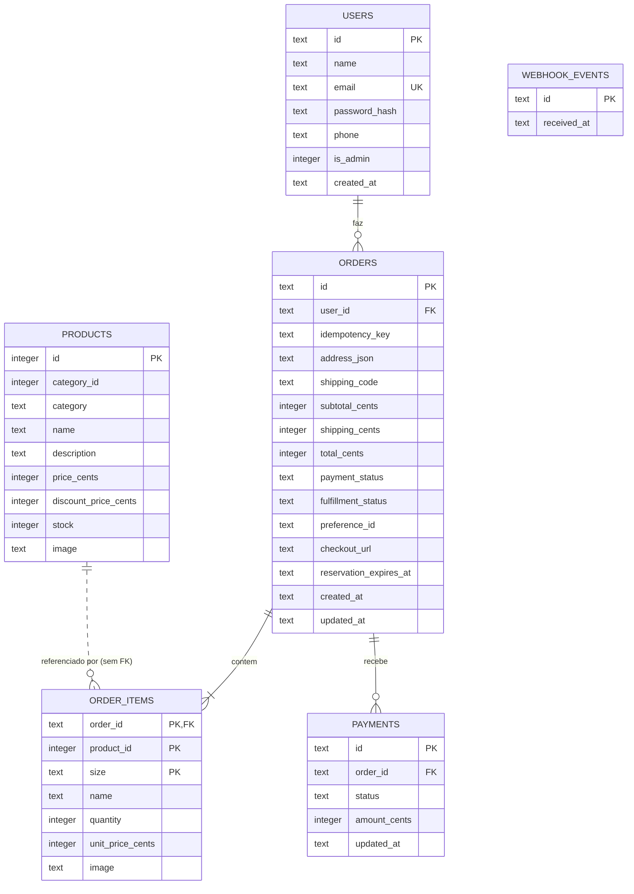

# DER — Galeria Seleta

Modelo das seis tabelas que o banco da API cria de verdade (`backend/src/db.js`). O script `database/schema.sql` descreve as mesmas tabelas, e um teste automatizado (`backend/test/api.test.js`) confere que os dois coincidem.

> Nota histórica: na Sprint 1 este diagrama trazia `services` e `appointments`, herdadas do enunciado genérico do roteiro. Elas saíram quando o escopo virou e-commerce puro, e entraram pedidos, pagamentos e eventos de webhook.

## Relacionamentos

- Um **usuário** faz zero ou vários **pedidos**; cada pedido pertence a um único usuário (`orders.user_id`).
- Um **pedido** tem um ou mais **itens** (`order_items.order_id`). A chave do item é pedido + produto + tamanho.
- Um **pedido** recebe zero ou vários **pagamentos** (`payments.order_id`), uma linha por pagamento, identificada pelo id do pagamento no Mercado Pago. A linha é atualizada a cada notificação que chega sobre aquele pagamento (`INSERT ... ON CONFLICT(id) DO UPDATE`), então notificações repetidas não criam linhas repetidas; é essa chave que garante a idempotência.
- O item do pedido guarda `product_id`, mas **sem chave estrangeira** para `products`. O item copia nome, preço e imagem do momento da compra, então apagar ou alterar um produto do catálogo não mexe no histórico de pedidos.
- **`webhook_events`** não se liga a nenhuma tabela. É o registro dos avisos recebidos do Mercado Pago (identificador e hora de recebimento), usado como trilha de auditoria; o código só grava nela e não a consulta. A idempotência do processamento está no `payments`, descrito acima.
- Pedidos têm a restrição `UNIQUE(user_id, idempotency_key)`, que impede criar dois pedidos quando o aplicativo repete a mesma tentativa de checkout.

## Convenções

- Todo valor em dinheiro é guardado em **centavos** (`*_cents`, inteiro). A API converte para reais ao responder.
- Datas são texto em formato ISO 8601 (UTC).
- `users.is_admin` vale 0 para cliente e 1 para administrador.
